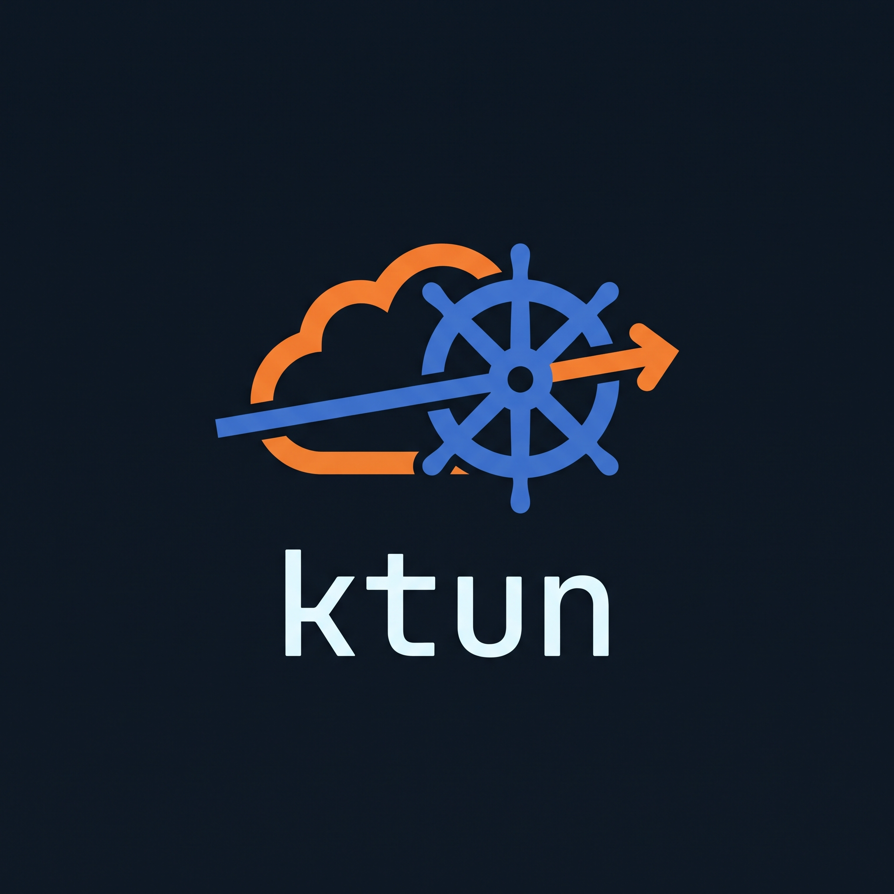
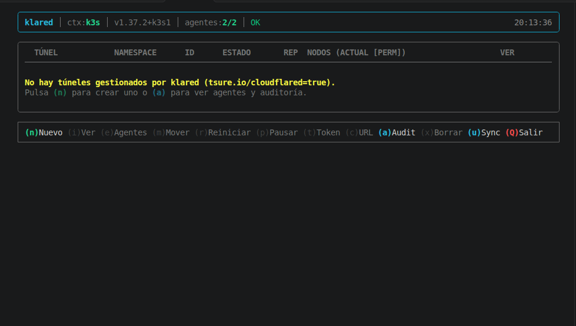
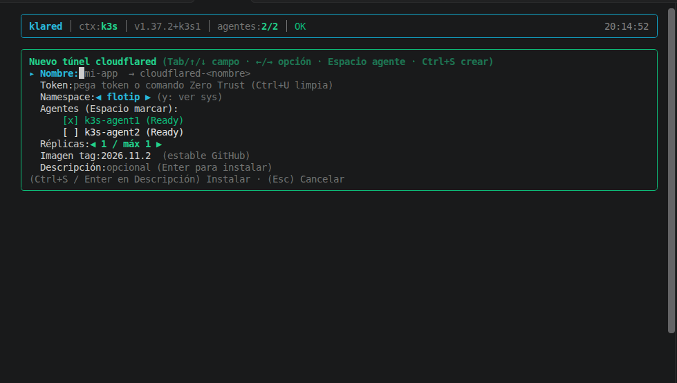

<div align="center">



# `klared` — Gestor TUI de Túneles `cloudflared` para k3s (`tsure.io/*`)


</div>

Herramienta interactiva de terminal (**TUI**) para instalar y administrar **túneles de Cloudflare administrados por dashboard** (*remotely-managed*, con token) dentro de un clúster **k3s**, sin operadores, sin CRDs y con consumo mínimo de RAM/CPU.

Depende únicamente de `kubectl` en tu equipo local. Antes de abrir el dashboard valida conectividad, agentes `Ready` y permisos RBAC, y a partir de ahí te permite instalar túneles, asignarlos selectivamente a agentes mediante labels `tsure.io/*`, trasladarlos sin corte, rotar tokens de forma segura y auditar labels huérfanos en total compatibilidad con **`k3access`**, **`kpg`** y **`tacl`**.



---

## Características principales

- **Validación Pre-Flight y modo `--check`:** comprueba `kubectl`, contexto activo, conectividad con el clúster, agentes worker `Ready` (excluyendo `control-plane`/`master`), permisos RBAC y lectura de namespaces.
- **Instalación guiada con rollback automático (`n`):** solicita nombre (DNS-1123), token enmascarado (acepta el token directo o el comando completo que entrega Cloudflare Zero Trust), namespace, agentes compatibles, réplicas y versión fija de `cloudflare/cloudflared`. Si el despliegue falla a mitad, revierte automáticamente Deployment, Secret y labels.
- **Asignación selectiva y traslado sin cortes (`e` / `m`):** combina `maxUnavailable: 0`, `readinessProbe` (`/ready:2000`), `topologySpreadConstraints` y `tolerations` de 30 s para failover rápido. Agrega labels en los nuevos agentes antes de evacuar los anteriores y revierte con `rollout undo` si el rollout expira.
- **Compatibilidad nativa con `k3access` (`tsure.io/*`):**
  - Lee (sin modificar) `tsure.io/node-selector` y `scheduler.alpha.kubernetes.io/node-selector` del namespace y calcula la intersección de agentes válidos.
  - Marca el namespace con `tsure.io/klared-<id>=true` para que `k3access` muestre el túnel activo en su columna `HERRAMIENTAS` y retire el label automáticamente al eliminarlo.
- **Seguridad estricta:** todas las llamadas pasan por `child_process.spawn('kubectl', args, { shell: false })`. El token del túnel **nunca** va en argumentos de línea de comandos ni en logs: siempre se envía por `stdin` a `kubectl apply -f -`.
- **Auditoría de huérfanos (`a`):** detecta labels `tsure.io/cloudflared-*` en nodos y `tsure.io/klared-*` en namespaces sin Deployment asociado, así como Deployments cuyos agentes ya no existen, ofreciendo limpieza manual confirmada (`LIMPIAR`).
- **Empaquetado standalone (SEA):** genera ejecutables autocontenidos para **Linux x64** y **Windows x64** sin requerir Node.js en destino, con instaladores verificados por **SHA-256**.

### Fuera de alcance (por diseño)

- No gestiona rutas ni hostnames del túnel: eso se configura manualmente en el dashboard de **Cloudflare Zero Trust** (aunque `klared` te muestra y copia las URLs internas sugeridas `http://<service>:<port>`).
- No usa la API de Cloudflare ni pide credenciales de cuenta: solo trabaja con el **token del túnel**.
- No crea ni borra namespaces (eso corresponde a `k3access`) ni modifica recursos de `kpg` o `tacl`.

---

## Recorrido visual

### 1. Validación inicial (Pre-Flight)
Al iniciar, `klared` verifica `kubectl`, contexto activo, agentes worker `Ready`, permisos RBAC (`Secrets`, `Deployments`, `patch` en `Nodes` y `Namespaces`) y namespaces existentes antes de habilitar el dashboard.


### 2. Dashboard principal en vivo
Muestra en tiempo real (refresco cada 5 segundos) todos los túneles gestionados (`tsure.io/cloudflared=true`) con su namespace, ID corto, estado, réplicas, nodos actuales vs. permitidos y versión fija de `cloudflared`. En la tira inferior destaca alertas de tráfico entre nodos (tailnet), estado `Pending` y la URL interna sugerida del namespace.


### 3. Instalación guiada de un túnel (`n`)
Valida el nombre DNS-1123 en vivo, recibe el token enmascarado (extrayéndolo automáticamente si pegas `cloudflared service install <TOKEN>` o `--token <TOKEN>`), deshabilita agentes `NotReady` o incompatibles con la afinidad del namespace, consulta la última versión estable de `cloudflare/cloudflared` (bloqueando `latest`) y ejecuta el despliegue con rollback automático en caso de error.



### 4. Inspección detallada (`i` / `Enter`)
Muestra el estado de cada pod, el nodo asignado, el estado `/ready`, reinicios, diagnóstico en caso de `Pending` o token inválido, la afinidad de solo lectura de `k3access`, los `Services` del namespace listos para copiar con `(c)` y los logs recientes del contenedor.


### 5. Cambio de asignación de agentes y réplicas sin corte (`e`)
Permite añadir o quitar agentes permitidos y ajustar el número de réplicas (`1 .. agentes elegidos`) mostrando el plan de ejecución antes de aplicar: primero etiqueta los nodos nuevos, evacúa sin corte si el pod corre en un agente descartado y finalmente retira los labels antiguos y actualiza `tsure.io/agents`.


### 6. Traslado inmediato entre agentes (`m`)
Fuerza el movimiento sin corte de un túnel hacia otro agente permitido y `Ready`, garantizando que el pod nuevo responda `/ready` en el destino antes de retirar el anterior y conservando intacto el conjunto completo de agentes permitidos.


### 7. Vista de agentes k3s y auditoría de huérfanos (`a`)
Resume cada agente worker conectado, sus labels `tsure.io/cloudflared-*` y los pods activos, y presenta el reporte de auditoría de huérfanos con limpieza manual confirmada escribiendo `LIMPIAR`.


### 8. Eliminación segura y limpieza total (`x`)
Detalla exactamente qué recursos y labels se eliminarán (`Deployment`, `Secret`, label en nodos y label `tsure.io/klared-<id>` en el namespace), solicita confirmar escribiendo el nombre exacto del túnel y recuerda al finalizar retirar manualmente las rutas en Cloudflare Zero Trust.


---

## Contrato de labels y anotaciones (`tsure.io/*`)

Regla de oro del ecosistema: **cada herramienta es dueña exclusiva de sus labels y nunca sobrescribe los de otra.**

| Recurso | Label / Annotation | Propósito |
| :--- | :--- | :--- |
| `Secret`, `Deployment`, `Pod` | `tsure.io/cloudflared: "true"` | Identifica los recursos propios de `klared`. Nunca modifica Deployments ajenos. |
| `Node` (agentes permitidos) | `tsure.io/cloudflared-<id>: "true"` | **Fuente de verdad** de los agentes donde puede ejecutarse el túnel (ID hex de 6 caracteres). |
| `Namespace` | `tsure.io/klared-<id>: "true"` | Marca de uso por túnel compatible con `k3access` (permite múltiples túneles independientes en un mismo namespace). |
| `Deployment` (annotations) | `tsure.io/tunnel-id`, `tsure.io/agents`, `tsure.io/description`, `tsure.io/desired-replicas` | Auditoría, espejo de agentes asignados, descripción y réplicas previas al pausar. |
| `Namespace` (solo lectura) | `scheduler.alpha.kubernetes.io/node-selector`, `tsure.io/node-selector` | Afinidad definida en `k3access`; `klared` la lee para calcular la intersección sin modificarla. |

### Diseño del Deployment generado

- **Sin `Service`, `NodePort` ni `Ingress`:** `cloudflared` solo abre conexiones salientes hacia Cloudflare.
- **Sin corte en traslados:** `strategy.rollingUpdate.maxSurge: 1`, `maxUnavailable: 0` y `readinessProbe` sobre `/ready` en el puerto de métricas `2000`.
- **Failover rápido (~30–60 s):** `tolerations` con `tolerationSeconds: 30` para `node.kubernetes.io/unreachable` y `node.kubernetes.io/not-ready` únicamente en este Deployment.
- **Reparto entre agentes:** `topologySpreadConstraints` por `kubernetes.io/hostname` (`maxSkew: 1`) para que con `replicas: 2` y 2 agentes quede 1 réplica por agente.
- **Consumo mínimo:** `requests: 10m CPU / 32Mi RAM`, `limits: 200m CPU / 128Mi RAM`.

---

## Requisitos previos

- **`kubectl`** instalado en el `PATH` del equipo local.
- Archivo `~/.kube/config` (o variable `KUBECONFIG`) apuntando a tu clúster k3s con permisos para crear/editar/borrar `Secrets` y `Deployments`, y hacer `patch` sobre `Nodes` y `Namespaces`.
- Un túnel creado previamente en **Cloudflare Zero Trust** (Networks → Tunnels) para obtener su token.
- **Node.js v20+** (solo si ejecutas desde código fuente o compilas ejecutables).

---

## Instalación y uso

### Instalación rápida (binario autocontenido, sin Node.js)

Los instaladores detectan automáticamente la última release en GitHub, verifican **SHA-256** (`SHA256SUMS.txt`) y actualizan si se vuelven a ejecutar.

**Linux (x64):**

```bash
curl -fsSL https://raw.githubusercontent.com/Tsurematsu/klared/main/scripts/install.sh | bash
```

**Windows (x64 — PowerShell):**

```powershell
curl.exe -fsSL https://raw.githubusercontent.com/Tsurematsu/klared/main/scripts/install.ps1 -o "$env:TEMP\klared-install.ps1"; powershell -ExecutionPolicy Bypass -File "$env:TEMP\klared-install.ps1"
```

Una vez instalado:

```bash
# Validación Pre-Flight + resumen de túneles y huérfanos sin abrir la TUI
klared --check

# Abrir la TUI interactiva
klared
```

### Desde código fuente (Node.js v20+)

```bash
# 1. Instalar dependencias
npm install

# 2. Validación rápida Pre-Flight
npm run dev -- --check

# 3. Abrir la TUI interactiva en desarrollo
npm run dev

# 4. Compilar TypeScript y ejecutar
npm run build
npm start
```

### Pruebas y empaquetado standalone (SEA)

```bash
# Chequeo estricto de tipos TypeScript
npm run typecheck

# Pruebas unitarias (DNS-1123, token, afinidad, manifiestos, kubectl, rollback y auditoría)
npm test

# Generar ejecutables autocontenidos en build/ (klared-linux-x64 y klared-win-x64.exe)
npm run build:sea:linux
npm run build:sea:win
npm run build:sea
```

---

## Atajos de teclado

### Menú principal (Dashboard)

| Tecla | Acción |
| :---: | :--- |
| `↑` / `↓` (o `j` / `k`) | Navegar por la lista de túneles (en la tabla) o ítems del panel rápido |
| `Tab` / `Shift+Tab` | Alternar foco entre la tabla de túneles y el panel rápido en lista (`Agentes`, `Mover`, `Réplicas`, `Namespace`) |
| `←` / `→` | Ajustar valor en el panel rápido (`Mover`, `Réplicas`, `Namespace`) |
| `Enter` | Abrir Inspección (desde la tabla) o abrir/aplicar el control enfocado (desde el panel) |
| `n` | Instalar un nuevo túnel (`Secret` + `Deployment` con rollback) |
| `i` | Abrir el menú de Inspección del túnel seleccionado |
| `z` | Abrir el asistente de URLs para Cloudflare Zero Trust (por namespace, `HTTP`/`HTTPS`/`TCP`, DNS corto/FQDN) |
| `l` | Ver la lista completa de namespaces (`k3access` + `default`) y mover el túnel sin corte |
| `u` | Refrescar manualmente (además del refresco automático cada 5 s) |
| `Q` / `Esc` | Volver a la tabla (desde el panel) o salir y restaurar la terminal |

### Menú de Inspección (`i` / `Enter`)

| Tecla | Acción |
| :---: | :--- |
| `r` | Reiniciar el Deployment (`rollout restart` con `rollout undo` si expira) |
| `p` | Pausar (escalar a `0`) y reactivar conservando Secret y labels |
| `t` | Rotar token (actualizar Secret por `stdin` y reiniciar) |
| `a` | Ver agentes k3s y ejecutar auditoría manual de huérfanos (`LIMPIAR`) |
| `c` | Copiar URL interna sugerida (`http://<service>:<port>`) al portapapeles |
| `x` | Eliminar túnel y limpiar labels con confirmación por nombre exacto |
| `u` | Refrescar estado y logs recientes del contenedor |
| `Esc` / `q` | Volver al menú principal |

---

## Flujo recomendado con `k3access` y Cloudflare Zero Trust

1. Crea el namespace de tu aplicación en **`k3access`** (por ejemplo `mi-app-1`, con o sin afinidad de agente).
2. Crea un túnel en **Cloudflare Zero Trust** (tipo *Cloudflared*) y copia el token o el comando de instalación.
3. Abre **`klared`**, pulsa **`(n)`**, pega el token, elige `mi-app-1` y los agentes permitidos (por ejemplo `k3s-agent1` y `k3s-agent2`).
4. Cuando quede `● Ready`, pulsa **`(c)`** para copiar la URL interna sugerida (ej. `http://backend:80`) y pégala en *Public Hostname* dentro de Zero Trust.
5. En **`k3access`**, `mi-app-1` mostrará automáticamente `klared-<id>` en la columna **HERRAMIENTAS** y quedará protegido contra edición o borrado accidental.
6. Al eliminar el túnel con **`(x)`** en `klared`, se retiran Deployment, Secret, labels de nodo y `tsure.io/klared-<id>` del namespace, dejándolo libre nuevamente en `k3access`.

---

## Estructura del proyecto

```text
klared/
├── images/                        # Capturas de pantalla referenciadas en este README
├── scripts/
│   ├── build-sea.mjs              # Empaquetado binario standalone (esbuild + node --build-sea)
│   ├── install.sh                 # Instalador/actualizador Linux x64 con verificación SHA-256
│   └── install.ps1                # Instalador/actualizador Windows x64 con verificación SHA-256
├── src/
│   ├── index.tsx                  # Pantalla alterna + modo --check + --help
│   ├── App.tsx                    # Orquestador PreFlight -> Dashboard, refresco 5s y modales
│   ├── types/k8s.ts               # Tipos de nodos, namespaces, túneles, auditoría y PreFlight
│   ├── utils/validation.ts        # DNS-1123, extracción/redacción de token, afinidad e intersección
│   ├── services/
│   │   ├── kubectl.ts             # Wrapper spawn('kubectl', args, { shell: false }) con stdin
│   │   ├── clipboard.ts           # Portapapeles multiplataforma + OSC52
│   │   ├── manifests.ts           # Generador YAML (Secret + Deployment) y consulta versión estable
│   │   ├── nodes.ts               # Lectura de nodos/agentes worker y metadata de namespaces
│   │   ├── preflight.ts           # Validación de kubectl, contexto, agentes Ready y RBAC
│   │   └── tunnels.ts             # CRUD, rollback, traslado sin corte, rotación, logs y auditoría
│   └── components/                # PreFlight, Header, Dashboard, FooterBar y todos los modales
└── tests/
    ├── validation.test.ts         # Pruebas de DNS-1123, token, versión y afinidad
    ├── manifests.test.ts          # Pruebas del generador de Secret y Deployment
    └── kubectl-and-flows.test.ts  # Pruebas del wrapper kubectl, rollback, traslado y huérfanos
```
